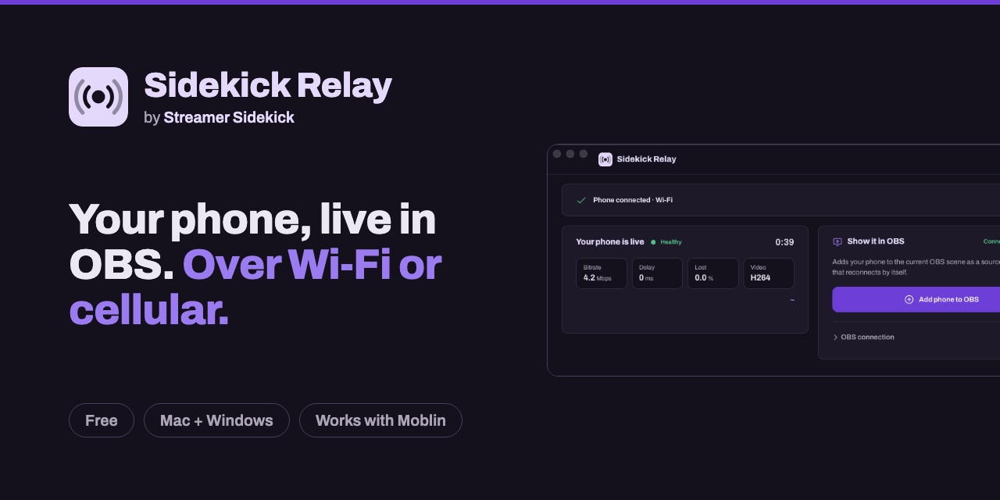

  

# Sidekick Relay downloads

**[Download the latest version →](https://github.com/Harl3yVT/sidekick-relay-releases/releases/latest)**

Sidekick Relay puts your phone camera into OBS on the same computer. Open the app, scan a QR code with your phone,
press Go Live in Moblin or Larix, and your phone is a source in your OBS scene. Same Wi-Fi or cellular, free.

| Your computer | File to download |
|---|---|
| Mac with Apple Silicon (M1 and newer) | `Sidekick.Relay_<version>_aarch64.dmg` |
| Mac with Intel | `Sidekick.Relay_<version>_x64.dmg` |
| Windows 10 or 11 | `Sidekick.Relay_<version>_x64-setup.exe` |

## First launch

Sidekick Relay isn't signed by Apple or Microsoft yet, so the first time you open it your computer asks if you trust it.

- **Mac:** open the app. When macOS says it can't check it, press **Done**, then go to **System Settings > Privacy &
  Security**, scroll down and press **Open Anyway** next to Sidekick Relay.
- **Windows:** if a blue "Windows protected your PC" box appears, press **More info**, then **Run anyway**.

The app updates itself: when a new version is out, it offers to update (never while you're live).

This repository only hosts the installers. Help, ideas and bug reports:
[streamersidekick.live](https://streamersidekick.live/?ref=relay-downloads).

## Made by Streamer Sidekick

Sidekick Relay is a free tool from [Streamer Sidekick](https://streamersidekick.live/?ref=relay-downloads), the
manager in your corner after every stream: it tracks your numbers, catches your best clips and keeps your Discord in
the loop. Starter is free.
